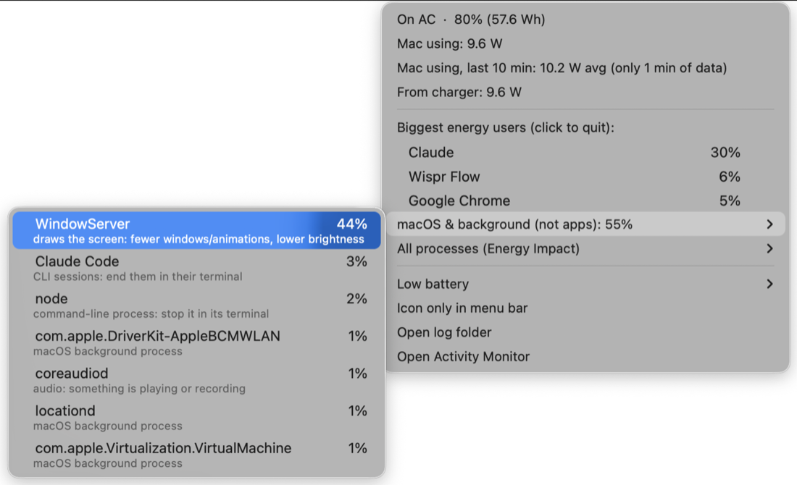

# Wattson - Macbook Battery Monitor

A MacBook battery monitor for the menu bar.


A [Hammerspoon](https://www.hammerspoon.org/) module that shows what Activity Monitor and Battery settings don't: real battery draw in watts, how long the battery will last at your recent rate, and which processes are eating it — including helpers that Activity Monitor groups away (iOS Simulator, browser renderers, etc.).

No sudo, no dependencies beyond Hammerspoon.

## What it does



- **Menu bar:** live watts and time left at the last-10-minute rate, e.g. `17W 1:05`. Turns orange above 15 W and red above 25 W (1-min average). Shows a plain ⚡︎ on AC, since draw there costs no battery.
  - **Icon only** (toggle in the menu, remembered across reloads): hides the numbers and shows just ⚡︎, which still turns orange/red, so it's there when you need it without being a distraction.
- **Menu:**
  - current watts, battery % and watt-hours left
  - average watts and predicted time left over the **last 10 min** and **last 1 hr**
  - macOS's own estimate, for comparison
  - on AC: what the Mac is using (now and 10-min average), what's going into the battery, and what's coming from the charger
  - **Quit to save battery:** the apps using the most energy, with every helper process (browser renderers, Electron helpers, …) counted under its app. On battery each row shows roughly how many watts the app accounts for and how much time quitting it would buy, e.g. `Google Chrome ≈4.2 W +0:35`, in orange from 2 W and red from 5 W. Click a row to quit the app. iOS Simulator is one entry, and quitting it also shuts down booted simulators.
  - **macOS & background:** everything that isn't an app you can quit (WindowServer, Spotlight, iCloud sync, `node` dev servers, …), each with a plain-English hint about what it is and what to do about it.
  - **All processes:** the raw list, with each process's Energy Impact score and share of the total.
- **Low battery:** at 20% on battery, a notification warns that the apps on your list will quit in 30 s (click it to keep them open), then quits them. Fires once per discharge and re-arms after charging past 25%. Starts with just Simulator; add or remove apps from the **Low battery** submenu.
- **Alerts:** a notification naming the top 3 apps when the 5-min average passes 20 W, or straight away when the 1-min average passes 35 W. Within one high-drain episode it re-alerts if drain climbs another 10 W, and otherwise reminds every 30 min; the episode resets once drain falls below 15 W.
- **Log:** one CSV line per minute in `~/.hammerspoon/power-logs/YYYY-MM.csv`: battery %, watts, 10-min average, top 5 processes.

History is cleared after sleep and on plug/unplug, so idle time doesn't make the estimate look better than it is.

Energy Impact is Apple's unitless score, and macOS has no per-process watts. The per-app watt figures split the drain above ~3 W of idle (display, chip) by each app's share of Energy Impact, so treat them as a guide to what's worth quitting, not a measurement.

## Install
**Copy this repo to your AI agent and tell it to install**

```bash
curl -o ~/.hammerspoon/wattson.lua https://raw.githubusercontent.com/optimisticnpc/wattson/main/wattson.lua
```

Add to `~/.hammerspoon/init.lua`:

```lua
-- Global so its timers and watchers aren't garbage collected.
wattson = require("wattson")
wattson.start()
```

Then reload Hammerspoon. To have it run at startup, turn on **Launch Hammerspoon at login** in Hammerspoon's preferences.

Upgrading from `powermon.lua`: delete it, and change `powermon` to `wattson` in `init.lua`. Your settings carry over.

## Configuration

Edit the constants at the top of `wattson.lua`:

| Constant | Default | Meaning |
| --- | --- | --- |
| `SAMPLE_SECS` | 15 | battery sample interval |
| `TOP_SECS` | 60 | process sample + log interval |
| `ALERT_WATTS` | 20 | sustained alert threshold (5-min average) |
| `SPIKE_WATTS` | 35 | spike alert threshold (1-min average) |
| `ESCALATE_WATTS` | 10 | re-alert when drain climbs this far past the last alert |
| `ALERT_COOLDOWN` | 30 min | reminder interval while drain stays high |
| `ALERT_RESET_WATTS` | 15 | episode ends below this (5-min average) |
| `WARN_WATTS` / `HIGH_WATTS` | 15 / 25 | orange / red menu bar text |
| `IDLE_WATTS` | 3 | draw left out of per-app watt estimates |
| `CLOSE_MIN_SHARE` | 2% | smallest share of activity to list an app under "Quit to save battery" |
| `LOW_BATTERY_PCT` | 20 | quit the low-battery apps at or below this |
| `LOW_BATTERY_REARM` | 25 | re-arm after charging past this |
| `LOW_BATTERY_GRACE` | 30 s | time to click "Keep open" before they quit |
| `LOG_DIR` | `~/.hammerspoon/power-logs` | where CSV logs go |

## How it works

- Watts = battery current × voltage, from `hs.battery` (the same SMC numbers `ioreg -rn AppleSmartBattery` exposes).
- Time left = remaining mAh ÷ average current over the window.
- On AC, Mac usage = charger input (`SystemPowerIn` from the battery controller's `PowerTelemetryData`) minus battery charging power (current × voltage). Its own `SystemLoad` field isn't used: it reports the charging power with the wrong sign for a few seconds when charging starts.
- Processes come from `top -o power` (two samples, so the energy column has a baseline), with each pid resolved to its full path. Processes inside an `.app` in an Applications folder are grouped under that app; everything else is labelled as macOS or command-line work.
